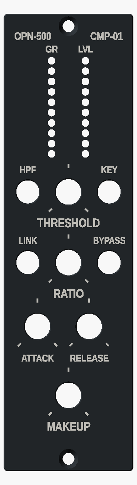

# 3D-printed faceplate

A faceplate you can print on an ordinary FDM printer, for anyone without a laser cutter,
CNC or panel shop. Same holes and legends as the `toggle` layout in [`../`](../README.md),
so it fits the front board as drawn.

| File | What it is |
|---|---|
| `faceplate-multicolor.3mf` | Panel and legend as one object with two parts, for a two-colour print in Bambu Studio or OrcaSlicer. |
| `faceplate-multicolor-prusaslicer.3mf` | The same for PrusaSlicer, which keeps its part table in a different file. |
| `faceplate-fit-test-multicolor.3mf`, `-prusaslicer.3mf` | The same pair for the fit test. |
| `faceplate.step` | The faceplate as a solid for CAD (Fusion, FreeCAD, SolidWorks, Onshape), with the legend as a second body. See [In CAD](#in-cad). |
| `faceplate-blank.step` | The same faceplate with no legend: every hole and LED slot, a plain front. |
| `faceplate-legend.dxf` | The legend and ticks as outlines, one layer per label, for laying out your own legend on the blank. |
| `faceplate.stl` | The faceplate, already flipped face down for printing, with the main-board bracket standing up off its back. |
| `faceplate-legend.stl` | The engraved legend and pot ticks as their own body, for a second colour. |
| `faceplate-fit-test.stl` | A 27 mm strip across THRESHOLD, HPF, KEY and the bottom of both meters. |
| `faceplate-fit-legend.stl` | The fit test's legend. |
| `faceplate-led-retainer.stl` | A thin plate that holds the meter LEDs in from the back. See [The LED retainer](#the-led-retainer). |
| `faceplate-led-retainer.step` | The retainer as a solid, placed where it sits on the back of `faceplate.step`. |
| `faceplate.scad` | The model. Every print setting is a parameter at the top. |
| `panel_data.scad` | Hole positions and legend text, written by `make_panel.py`. Don't edit it. |
| `build.sh` | Re-runs `make_panel.py`, exports all five STLs (a few minutes), builds the 3MFs and, if CadQuery is installed, the STEPs. |
| `make_3mf.py` | Combines each panel and legend STL into the two 3MFs. |
| `make_step.py` | Builds the three STEPs and the legend DXF from the same two `.scad` files. |

## What's different from the metal panel

- **Thickness:** 3.2 mm, the same as the 1/8″ metal panel, so the rack screws and everything
  behind the panel sit exactly where the front board expects. The back is flat apart from
  the two meter slots, the two pin holes for the LED retainer and the main-board bracket.
- **Pots:** the front is flat round the pots, so the knobs sit down close to the panel. The
  Altronics 9 mm pots have no threaded bushing or nut; they're held by the front board,
  and the board by the toggle nuts, so the pot holes are just clearance for the shafts.
- **Meter LEDs:** sized for Jaycar's 2 mm tower LEDs (ZD0060 orange, ZD0070 green, ZD0040
  red), as measured: a 2.0 mm round tower, 1.5 mm tall, on a 3.25 × 2.5 mm base. Each tower
  pushes into a 2.2 mm hole from the back, and the base's shoulder stops in a 3.55 mm slot,
  1.7 mm deep, that runs down the back of each meter column. That puts the tower tips flush
  with the front and lines all twenty up. The LED sizes are parameters at the top of
  `faceplate.scad` (`led_tower_d`, `led_tower_h`, `led_base_w`, `led_base_l`, plus
  `led_proud` to stand the tips out or sink them in).
- **Fit allowance:** pot, toggle and screw holes print 0.2 mm larger than drawn
  (`hole_comp`), and the LED holes 0.2 mm larger than the tower (`led_comp`), because FDM
  holes come out undersize. That leaves 0.8 mm of plastic between neighbouring LED holes, and
  1.5 mm in front of the slots.
- **Width and height:** 37.8 × 132.6 mm rather than the nominal 38.10 × 133.35, so it slides in
  beside the next module. The front edge has a 0.4 mm chamfer so first-layer squish doesn't
  flare it.
- **Legend:** engraved 0.6 mm into the front, 30% larger than on the mockup (the mockup's
  1.4 to 1.7 mm capitals are too fine for a 0.4 mm nozzle). Every stroke is grown 0.15 mm
  each side (`legend_bold`) so the thin strokes come out 0.5 mm or wider, more than one
  nozzle line, and the letters are spaced 20% wider (`legend_spacing`) to keep them apart.
  Each pot gets three 0.6 mm wide ticks: start, middle and end of travel.

## Printing it

1. **Print the fit test first.** It's a short print. Check that a pot and a toggle drop
   through their holes, the knobs sit close to the front, and an LED tower pushes
   into its hole from the back with the base sitting in the slot and the tip flush with the
   front. If a hole is tight or loose, change `hole_comp` in `faceplate.scad` and run
   `./build.sh` (or open the file in OpenSCAD and use the Customizer).
2. **Material:** PETG in black or dark grey. A light colour lets each meter LED glow through
   the thin walls on either side of its hole. PETG over PLA because a rack runs warm and
   PLA slowly gives way under a tightened nut.
3. **Settings:** 0.4 mm nozzle, 0.2 mm layers, 4 walls, 100% infill, no supports. Print it as
   exported, face down, so the legend and the front come out against the bed. The LED slots
   end up on top, open, and the bracket stands straight up with 45° undersides on its ears,
   so none of it needs supports. The bracket's wall is only 1.1 mm thick, so slow the print
   down for its upper layers if your printer wobbles tall thin walls. A textured PEI sheet gives the front a nice finish.
4. **Two colours (optional):** in Bambu Studio or OrcaSlicer, import `faceplate-multicolor.3mf`
   (File, Import, or Cmd/Ctrl+I); in PrusaSlicer use `faceplate-multicolor-prusaslicer.3mf`.
   It loads as one object with two parts already lined up: the panel on filament 1 and the
   legend on filament 2. Pick a dark filament for 1 and a light one for 2. The file carries no
   print settings, so opening it as a project in Bambu Studio says it is loading geometry
   only; that's expected. Both colours share the first 0.6 mm (three 0.2 mm layers, or a
   0.2 mm first layer and five 0.08 mm layers), so it needs a multicolour unit (AMS, MMU) or a
   second nozzle, but it only swaps on those layers.
   With one colour, print `faceplate.stl` and fill the engraving afterwards with paint or a
   white wax crayon rubbed in and wiped off.

## The main-board bracket

The faceplate carries its own bracket for the main board, printed in one piece with it. A
1.1 mm wall stands 34 mm off the back along the panel's left edge (seen from the front),
just outside the front board. Two ears on it reach in behind the front board to the main
board's two M3 holes, H1 and H2, on the board's solder side. Each ear has a slot for an M3
nut, open at the back end.

To fit the main board, drop an M3 nut into each ear's slot. Put an M3 × 8 screw through
H1 and H2 from the component side, and tighten it into the nut. The screw hole in each ear
is a 3 mm slot along the depth, and the nut slides in its slot to suit, so the board can sit
a little nearer the panel or further back. Trim the lead ends on the back of the front
board flush where the ears pass behind it.

It's drawn from the 500-series spec and the board files, and none of these numbers have been
checked in a rack yet. They're all parameters at the top of `faceplate.scad`:

- **Sideways:** the rack's edge connector, and so the main board, sits 11.12 mm left of the
  panel's centreline (`board_offset`). The ears stop 0.3 mm short of the board's solder side
  (`bracket_gap`), so use a washer as a shim if it sits further over in your rack.
- **Depth:** the board's front edge is 24 mm behind the panel (`board_setback`), as the
  boards were designed. The slots allow ±1.5 mm.
- **Height:** the 105 mm card is centred on the 133.35 mm panel (`board_top`). The wall stays
  inside the rack's 118.42 mm opening, clear of the rails behind the panel's top and bottom.

The bracket is plastic, so it doesn't tie the panel to CHASSIS the way a metal bracket on
H2 would. Set `bracket = false` for a plain panel to use with a metal angle instead. The
fit-test strip leaves the bracket off.

## The LED retainer

`faceplate-led-retainer.stl` is a 16.5 × 32.8 mm plate, 1.2 mm thick, that covers the back of
both meters. A rib on it goes into each LED slot and presses on the backs of the LED bases,
which holds every LED firmly in the panel. Two 2 mm pins between the meters press into blind
holes in the back of the panel. Each LED's two leads pass through their own pair of holes
on the 2.54 mm pitch of the front board's pads.

Print it flat as exported, with the ribs and pins facing up, in the same PETG at 0.2 mm
layers. The ribs are one layer (0.2 mm) taller than the slots need, which is the squeeze
on the LEDs.

To fit it:

1. Push all twenty LEDs into the panel from the back, with the flat (cathode) side the way
   the front board's silkscreen shows. Watch which way round each column goes: the two
   columns face opposite ways.
2. Thread each LED's leads through the retainer's holes and press the retainer on until
   its pins are home. A drop of glue on each pin makes it permanent, if the pins come out
   loose.
3. Fit the front board over the leads, tighten the toggle nuts, and solder the LEDs.

If the pins are loose or too tight to press home, change `retainer_pin_fit`. If the LEDs
still rattle, raise `retainer_press` to 0.4. Both are at the top of `faceplate.scad`.

## In CAD

`faceplate.step` is the same faceplate as a real solid model: true cylinders, cones and
fillets rather than a mesh, so you can measure it, add features, or line it up with the
boards' STEP exports. It is in millimetres, front face up, with x to the right and y up. The
origin is the bottom-left corner of the nominal 38.10 × 133.35 mm panel, so the printed
outline starts at (0.15, 0.375); the back face is at z = 0 and the front at z = 3.2.

It holds two components, coloured as the two-colour print:

- **panel**, dark grey, with the legend and ticks engraved 0.6 mm into the front.
- **legend**, off-white, the inlay that fills the engraving, one small body per letter and
  tick. Hide or delete it if you only want the panel.

In Fusion, use File, Open, Open from my computer and pick `faceplate.step`.

### Your own legend

`faceplate-blank.step` is the panel with no legend, and `faceplate-legend.dxf` is the
legend as closed outlines (lines and curves, not text), in the same coordinates as both
STEPs. Each label is on its own layer (`GR`, `LVL`, `THRESHOLD`, ...), and so are each
pot's ticks (`TICKS-THRESHOLD`, ...). `OUTLINE`, `HOLES` and `KNOBS` (the 12 mm knob
outline from the drawing) are there to line things up and aren't meant to be cut.

In Fusion: open the blank, then Insert, Insert DXF, and pick the front face as the plane. If
the dialog offers a single-sketch option, turn it off so each layer comes in as its own
sketch, which makes a label easy to select and move. Move or delete labels, then Extrude
the outlines into the face by -0.6 mm with Cut for an engraved legend. For a second colour,
extrude the same profiles again as a New Body, which gives you the inlay.

`make_step.py` builds all three with CadQuery from `faceplate.scad` and `panel_data.scad`, so it
follows any change to `hole_comp`, the LED sizes, the legend settings or the hole positions:
`pip install cadquery uharfbuzz shapely`, then `python3 make_step.py` (about ten seconds). It lays out
the legend the way OpenSCAD 2021 does, using the font's own curves; checked against the
STLs, 99% of their vertices sit within 0.007 mm of the STEP's edges and all of them within
0.11 mm.

## Fitting it

- Snap the small anti-rotation tab off the front of each pot, as you would for a metal
  panel, or it holds the pot off the back of the panel.
- Tighten the toggle nuts gently. Plastic creeps, and the nuts only need to hold the board.
- A plastic panel doesn't ground the pot and toggle bushings the way an anodised panel tied
  to CHASSIS does. If touching a knob adds hum, run a wire from a solder tag under one toggle's
  nut to the main board's CHASSIS (H2).
